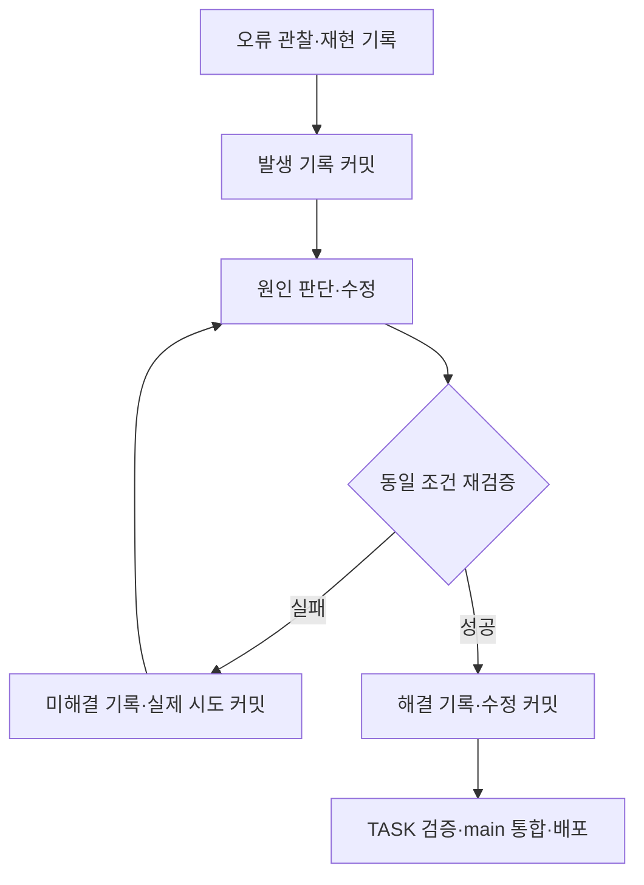

# TASK 및 오류별 커밋 규칙

이 규칙은 사용자가 추가한 개발 요구사항이다. 코드뿐 아니라 실제 판단·검증·문서 변경을 구분하여 기록한다. 커밋 개수를 맞추기 위한 빈 변경을 만들지 않는다.

## 커밋 시점

| 시점 | 반드시 남길 실제 변경 | 메시지 예시 형식 |
| --- | --- | --- |
| TASK의 기능 단위 완료 | 구현 파일, 실제 검사 결과, TASK 기록 | feat(T04): 실제 메뉴 이동 구현 내용 |
| 오류 최초 발견 | 재현 조건·관찰 결과·기대 결과·영향·근거를 적은 이슈 문서 | docs(T04/I001): 발견한 메뉴 오류와 재현 조건 |
| 오류 원인 확인·수정 시도 | 실제 진단·변경·시도 결과. 해결되지 않았으면 open 상태 유지 | fix(T04/I001): 실제 수정한 원인과 내용 |
| 오류 해결·재검증 완료 | 수정 코드와 동일 조건 재검증 결과·남은 한계 | fix(T04/I001): 실제 수정 내용과 재검증 결과 |
| TASK 완료 | 구현 방식·파일·시각화·검사·연관 이슈·관련 커밋이 갖춰진 TASK 기록 | docs(T04): 구현 및 검증 기록 완료 |

메시지 예시는 형식만 제시한다. 이 오류들이 실제 발생했다는 뜻이 아니다. 원인 확인 없이 fix나 resolved를 쓰지 않는다.

오류를 발견하면 고치기 전에 관찰·재현 조건을 먼저 문서화해 커밋한다. 수정 뒤에는 재검증 결과를 포함하여 다시 커밋한다. 수정 시도가 실패했어도 실제 변경과 관찰은 남기되 미해결이라고 기록한다. 같은 오류가 같은 조건에서 반복 출력되는 것은 같은 이슈로 묶고, 새로운 재현 조건·진단·수정·결과가 있을 때 의미 있는 기록을 남긴다.

한 커밋이 오류 해결과 TASK 완료를 동시에 충족하면 TASK ID와 ISSUE ID를 함께 연결한다. 추가 빈 커밋을 만들지 않는다. 실제 작업이 크면 같은 TASK를 설정·콘텐츠·동작·검증의 독립 변경으로 나누되 숫자·날짜만 바꾸는 분할은 하지 않는다.

## 커밋과 push 구분

1. 먼저 사용자 작업 폴더의 Git 상태·현재 브랜치·원격·미커밋 변경을 확인한다. 기존 변경을 임의로 되돌리거나 섞어 커밋하지 않는다.
2. 기존 프로젝트 운영 방식을 존중하되 초기 개발은 TASK별 작업 브랜치를 기본안으로 사용한다. 빈 저장소라면 실제 원본 등록을 먼저 하고 TASK 브랜치를 만든다. 원본 등록은 유효 개수에서 제외한다.
3. 오류 발생 기록은 작업 브랜치에 먼저 커밋한다. 오류를 일으킨 코드의 변경이 필요하면 재현에 필요한 범위만 함께 보존한다. 오류 커밋 때문에 즉시 main에 push할 필요는 없다.
4. TASK의 필요한 검사와 빌드가 끝나면 main에 원래 커밋을 유지하는 merge 또는 fast-forward 방식으로 통합하고 push한다. squash·일괄 amend·rebase로 이력을 줄이거나 force push하지 않는다.
5. main push 후 Actions URL·결과·해당 SHA·공개 화면을 확인한다. 오류가 나오면 별도 이슈로 기록하고 수정·재배포한다. 초기 배포 뒤 실제 수정 push와 공개 반영도 확인한다.
6. 플랫폼의 권한·계정 설정 때문에 실행이 막히면 현재 상태와 필요한 사용자 작업을 구체적으로 남기고, 독립적으로 할 수 있는 작업을 계속한다.

TASK 브랜치와 커밋 메시지 형식은 구현을 관리하기 위한 제안이다. main 최종 제출·push 자동 실행·실제 이력·유효 커밋 집계는 채점 기준에 따른 요구사항이다.

## 각 커밋 전후 확인

- git status와 git diff로 이번 변경 범위를 확인한다.
- 관련 경로를 명시하여 stage하고 git diff --cached로 실제 들어갈 내용을 검토한다. 사용자 파일 전체를 무조건 add하지 않는다.
- 토큰·계정 비밀·개인 환경 파일·비공개 앱 로그는 커밋하지 않는다. 이슈에는 필요한 부분을 가린 최소 재현 정보만 남긴다.
- 변경에 맞는 검사를 실행하고 실제 결과를 문서에 적는다. 도구가 없거나 실행하지 못했으면 그대로 명시한다.
- 커밋 후 전체 SHA·메시지·변경 파일을 확인하여 TASK와 ISSUE 기록에 연결한다.
- 커밋 자신의 SHA를 그 커밋 내용에 넣으려고 amend를 반복하지 않는다. 다음 실제 기록 커밋 또는 별도 내보낸 집계에서 이전 SHA를 연결한다.
- Git 작성자 설정이 없으면 사용자에게 값을 확인한다. 보고서용 개인정보를 임의로 재사용하지 않으며 글로벌 설정을 바꾸지 않는다.

## 유효 커밋 집계

공개 P51은 최종 main SHA에 포함된 실제 본인 과제 작업의 유효 커밋 50개 이상을 요구한다. TASK 9개를 한 번씩 커밋하는 것만으로 50개가 되는 것은 아니다.

- 실제 설정·콘텐츠·코드·문서 수정이 있는 의미 있는 작업만 근거와 함께 검토한다. AI 도움 여부만으로 제외하지 않는다.
- 원본 테마 이력, 원본 ZIP 단순 등록, 빈 커밋, 봇·빌드 산출물만의 자동 커밋, 자체 변경 없는 병합, 번호·날짜 변경이나 바꿨다 되돌리는 채우기용 변경은 제외한다.
- 오류 발견 문서도 실제 관찰·재현·판단을 담았는지 diff를 보고 판단한다. 오류 커밋이라는 이유만으로 자동 유효 처리하지 않는다.
- 단순 자동 PDF 재생성만으로 유효 커밋을 늘리지 않는다. 원문 기록의 실제 변경과 연결한다.
- 집계 시작 SHA와 포함 여부, 최종 전체 SHA, 전체 후보 N·제외 E·유효 N-E, 제외 이유와 이력 링크를 기록한다.
- 비공개 커밋 추가 기준의 정확한 개수·배점은 공개 자료에 없어 모른다. 50개가 전체 만점 보장이라고 쓰지 않는다.

## 오류 기록 흐름

근거: 공개 채점기준 7쪽 P51~P57, 8쪽 P63~P65·P69~P70, 10쪽 공개 커밋 기준과 집계, 보고서 템플릿 3~7절. Git 이력 유지 방식은 공식 git-merge 문서와 대조했다: https://git-scm.com/docs/git-merge . 커밋의 변경 기록은 https://git-scm.com/docs/git-commit 를 참고한다.
