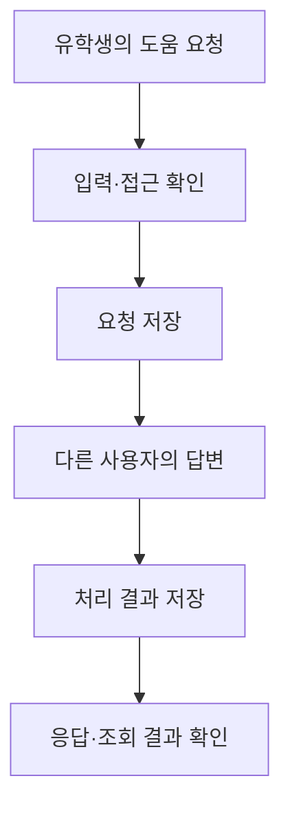

# T03 — KONNECT 백엔드 중간 작업 기록

정리일: 2026-11-05 KST, 결과 설명 보완: 2026-11-06 KST. 활동은 진행 중임. 2026년 초 시작한 팀 프로젝트이며 본인은 2학기 인수인계 이후 백엔드를 맡아 참여하고 있음.

이 문서는 실제 구현·테스트와 기존 로컬 검증 기록을 읽어 대조한 공개용 중간 결과임. 원본 코드·운영 로그·개인정보는 포함하지 않았음. 확인 범위는 구현 읽기 대조와 2026-11-04의 기존 실행 기록으로 한정하였음.

## 해결하려는 문제와 역할

유학생이 필요한 도움을 요청하고 관련 경험이 있는 다른 사용자가 답변으로 경험을 나눌 수 있도록 돕는 플랫폼임. 팀 전체의 플랫폼 제작과 본인의 백엔드 작업을 구분함. 백엔드에서는 도움 요청·답변의 입력 검증, 접근 권한, DB 저장과 상태 변경, API 연동 확인을 다룸. Codex로 제작하고 Claude로 검토하며 AI의 제안을 직접 확인하는 방식으로 공부하고 있음.

## 무엇을 어떤 방식으로 처리하는가

| 단계 | 처리 대상 | 구현에서 확인한 방식 | 이 방식이 필요한 이유 |
| --- | --- | --- | --- |
| 1. 요청 형식 | 요청 제목·본문·분야, 답변 본문 | NestJS DTO로 입력 형식과 필수값을 확인함. | 잘못된 입력을 DB 저장 전에 구분하기 위해서다. |
| 2. 접근 확인 | 기능별 요청 | 각 기능에 맞는 접근 검사를 거친다. 세부 판정 정책은 공개하지 않음. | 기능의 사용 범위에 맞는 요청인지 확인하기 위해서다. |
| 3. 저장과 조회 | 도움 요청·답변·처리 결과 | TypeORM으로 PostgreSQL에 저장하고 저장·조회 결과를 대조함. | 화면과 데이터의 흐름을 함께 확인하기 위해서다. |
| 4. 로컬 확인 | HTTP 응답과 DB의 상태 | 가상 계정·격리 PostgreSQL을 사용하는 Jest/Supertest 통합 테스트에 정상·입력 오류·인증·권한 조건이 정의되어 있음. | 서버와 연결되는 웹앱이므로 배포 전에 응답과 저장 결과를 함께 확인하기 위해서다. |

## 실제 데이터 처리 흐름

이 그림은 위 구현을 설명하기 위해 정리한 흐름도다. 실제 앱 화면 캡처나 운영 사용자의 사례가 아님.

## 무엇을 확인했는가

아래는 현재 구현과 통합 테스트를 읽어 확인한 내용임. 테스트에 검증 조건이 있다는 확인과, 테스트를 실행해 통과했다는 결과는 구분함. 세부 정책·입력 한도·응답 대응표는 공개하지 않음.

| 시나리오 | 확인 관점 | 구현·테스트 읽기 대조 결과 |
| --- | --- | --- |
| 정상적인 요청·답변 처리 | 처리 결과와 저장·조회 결과를 어떻게 비교하는가 | 서비스의 저장·조회 처리와 통합 테스트의 기대 결과가 정의되어 있음을 확인하였음. |
| 유효하지 않은 입력 | 잘못된 입력을 어떻게 구분하는가 | DTO 입력 검증과 입력 오류를 확인하는 테스트가 있음을 확인하였음. |
| 접근이 허용되지 않는 동작 | 접근을 제한하는 처리가 있는가 | 기능별 접근 검사와 관련 실패 조건을 확인하는 테스트가 있음을 확인하였음. |
| 유효하지 않은 처리 상태 | 처리 상태를 어떻게 확인하는가 | 상태 처리 구현과 관련 기대 결과를 확인하는 테스트가 있음을 확인하였음. |

### 기존 실행 기록에서 확인한 결과

2026-11-04 도움 기능 변경 검증 기록을 다시 읽어 아래 결과를 확인하였음. 원본 로그 대신 검사 종류·관찰된 결과·적용 범위만 요약함.

| 검사 종류 | 기존 기록의 실제 결과 | 이 결과가 설명하는 범위 |
| --- | --- | --- |
| 도움 기능 변경 회귀 검사 | 해당 변경 범위의 검사가 통과한 것으로 기록되어 있음. | 2026-11-04 도움 기능 변경 범위에 대한 회귀 확인 결과임. |
| 빌드 | 성공으로 기록되어 있음. | 해당 시점 소스의 빌드 결과임. |
| 타입 검사 | 성공으로 기록되어 있음. | 해당 시점 소스의 타입 검사 결과임. |

위 표는 기존 실행 기록을 읽어 확인한 결과다. 이번 포트폴리오 보완에서 KONNECT 테스트·빌드·타입 검사를 재실행하지 않았음. 현재 포트폴리오 웹사이트의 브라우저 검사와도 별개다.

## 배운 점과 남은 범위

AI의 제안은 실제 동작과 대조해야 한다는 점을 배웠음.

다음에는 도움 요청 API의 정상·입력 오류·권한 오류 테스트를 작성하고, 예상 응답과 실제 응답을 표로 비교해 검증을 반복할 수 있도록 개선할 계획임. 이는 사용자가 선택한 향후 학습 행동이며 이번 보완에서 완료한 실적이 아님.
