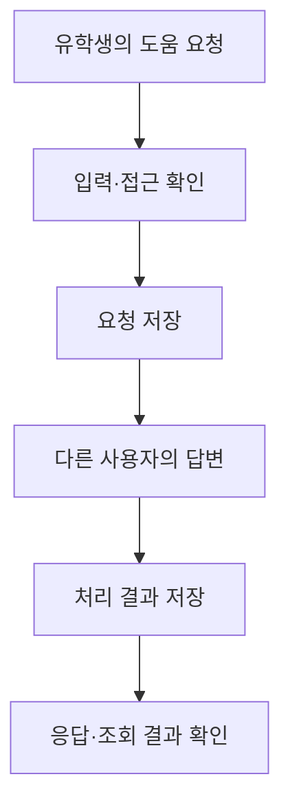

# T03 — KONNECT 백엔드 중간 작업 기록

정리일: 2026-11-05 KST. 활동은 진행 중이다. 2026년 초 시작한 팀 프로젝트이며 본인은 2학기 인수인계 이후 백엔드를 맡아 참여하고 있다.

이 문서는 실제 구현·테스트와 기존 로컬 검증 기록을 읽어 대조한 공개용 중간 결과다. 원본 코드·운영 로그·개인정보는 포함하지 않았다. 이번 포트폴리오 편집 중 KONNECT 테스트를 새로 실행한 기록이나 전체 서비스의 출시 승인서가 아니다.

## 해결하려는 문제와 역할

유학생이 필요한 도움을 요청하고 관련 경험이 있는 다른 사용자가 답변으로 경험을 나눌 수 있도록 돕는 플랫폼이다. 팀 전체의 플랫폼 제작과 본인의 백엔드 작업을 구분한다. 백엔드에서는 도움 요청·답변의 입력 검증, 접근 권한, DB 저장과 상태 변경, API 연동 확인을 다룬다. Codex로 제작하고 Claude로 검토하며 AI의 제안을 직접 확인하는 방식으로 공부하고 있다.

## 무엇을 어떤 방식으로 처리하는가

| 단계 | 처리 대상 | 구현에서 확인한 방식 | 이 방식이 필요한 이유 |
| --- | --- | --- | --- |
| 1. 요청 형식 | 요청 제목·본문·분야, 답변 본문 | NestJS DTO로 입력 형식과 필수값을 확인한다. | 잘못된 입력을 DB 저장 전에 구분하기 위해서다. |
| 2. 접근 확인 | 기능별 요청 | 각 기능에 맞는 접근 검사를 거친다. 세부 판정 정책은 공개하지 않는다. | 기능의 사용 범위에 맞는 요청인지 확인하기 위해서다. |
| 3. 저장과 조회 | 도움 요청·답변·처리 결과 | TypeORM으로 PostgreSQL에 저장하고 저장·조회 결과를 대조한다. | 화면과 데이터의 흐름을 함께 확인하기 위해서다. |
| 4. 로컬 확인 | HTTP 응답과 DB의 상태 | 가상 계정·격리 PostgreSQL을 사용하는 Jest/Supertest 통합 테스트에 정상·입력 오류·인증·권한 조건이 정의되어 있다. | 서버와 연결되는 웹앱이므로 배포 전에 응답과 저장 결과를 함께 확인하기 위해서다. |

## 실제 데이터 처리 흐름

이 그림은 위 구현을 설명하기 위해 정리한 흐름도다. 실제 앱 화면 캡처나 운영 사용자의 사례가 아니다.

## 무엇을 확인했는가

아래는 현재 구현과 통합 테스트를 읽어 확인한 검증 범주다. 기존 실행 결과와 이번 읽기 대조를 구분하며 세부 정책·입력 한도·응답 대응표는 공개하지 않는다.

| 시나리오 | 확인 관점 | 이번 정리에서 확인한 근거 |
| --- | --- | --- |
| 정상적인 요청·답변 처리 | 예상한 처리 결과와 저장·조회 결과의 일치 | 서비스 처리와 통합 테스트의 기대 결과 대조 |
| 유효하지 않은 입력 | 적절한 오류 처리 | DTO의 입력 검증과 관련 테스트 대조 |
| 접근이 허용되지 않는 동작 | 적절한 실패 처리 | 접근 검사와 관련 테스트 대조 |
| 유효하지 않은 처리 상태 | 의도한 상태 처리 | 처리 결과와 관련 테스트 대조 |

기존 2026-11-04~05 도움 기능 변경 검증 기록에는 해당 범위의 회귀 검사, 빌드·타입 검사 성공이 기록되어 있다. 기존 기록을 요약한 것이며 이번에 재실행한 결과가 아니다. 현재 포트폴리오의 브라우저 검사와도 별개다.

## 배운 점과 남은 범위

AI의 제안을 그대로 사용하지 않고 로그·기능·테스트 기대 결과를 대조하며 공부한다. 모든 문제를 완벽하게 해결하려는 태도를 조정하려는 과제도 있다. 이 기록은 도움 요청·답변 처리의 중간 결과를 설명하며 전체 앱 완성·포괄적인 보안 승인·실제 외부 서비스 연동 성공을 주장하지 않는다.

## 포트폴리오 반영과 이력

공개 화면의 #current에 목적·역할·작업 네 단계와 이 기록의 링크를 연결한다. 한국어·영어 본문은 기존 site/layouts/landing/list.html, 스타일·동작은 기존 site/assets/css/portfolio.css와 site/assets/js/portfolio.js를 재사용한다. 모호한 ‘백엔드 연결’·‘로컬 확인’을 구체화한다.

2026-11-05 이전에는 공개 결과가 없다는 선택을 유지했다. 이후 사용자의 ‘설명을 더 자세히 하고 빈칸을 채우기’ 요청에 따라 기존 구현과 검증 내용을 정리한 이 중간 기록을 공개한다. 원본 KONNECT 저장소를 공개하거나 코드를 복사하는 변경은 아니다. 이전 프론트·활동 이력: 8919f2b, 91700fb, 7b2cc20, ae55ecc, e4f99ab.
